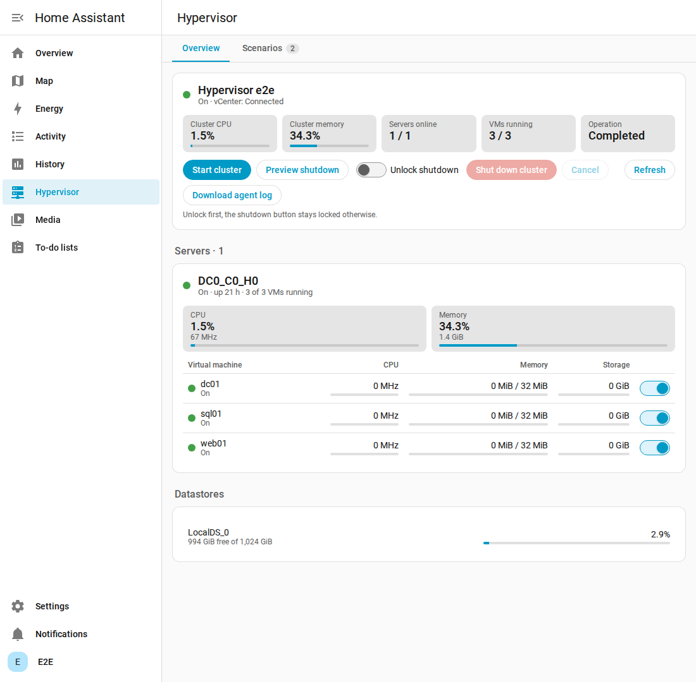
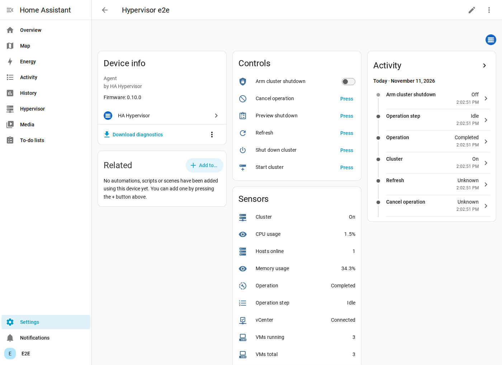
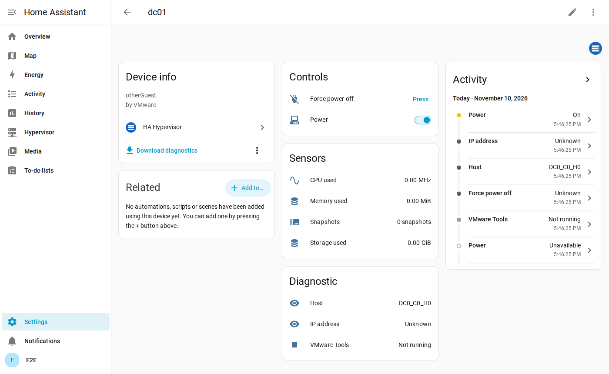
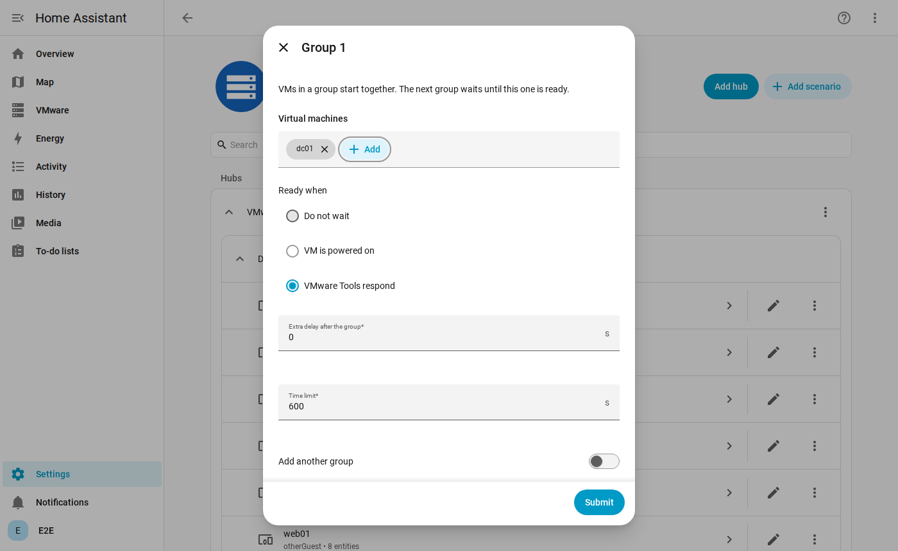

# HA Hypervisor

Home Assistant control of a hypervisor lab that Home Assistant cannot reach directly: statistics, VM power,
cluster shutdown and start, and start scenarios. Supports VMware vSphere and Proxmox VE 9 (one node, a cluster, a
cluster with HA), one agent per platform. Polish version: [README.pl.md](README.pl.md).

**[Installation guide](docs/installation.md)**



*Screenshots come from Home Assistant 2026.11 connected to `vcsim`, a vSphere simulator, so most metrics are low
and host names are generated.*

```
Home Assistant + this integration  <->  Mosquitto  <--MQTT over TLS--  agent
                                                                         |-- vCenter and ESXi API, or
                                                                         |-- Proxmox VE API (8006)
                                                                         '-- BMC (Redfish, IPMI), Wake on LAN
```

The agent opens the connection, so nothing needs to reach into the vCenter network. vSphere and BMC credentials
stay on the agent.

**The agent must run outside the cluster**, on an always-on machine in the management network. Otherwise it stops
with the cluster and nothing can start it again.

Requires Home Assistant 2026.11 or newer with the MQTT integration.

## What you get

| Device | Entities |
|---|---|
| Agent / cluster | cluster state, CPU and memory usage, hosts online, VMs running, operation and step, buttons: preview shutdown, shut down, start, cancel, refresh, arm switch |
| Host | CPU, memory, uptime, power state, connection |
| VM | power switch (guest shutdown), force power off, CPU, memory, storage, IP, host, guest tools, snapshots |
| Datastore | used %, free, capacity |
| Scenario | start, stop, state |

Numeric sensors have a state class, so Home Assistant keeps long-term statistics. Values come from vSphere quick
stats: disk and network throughput are not collected.

| Cluster | Virtual machine |
|---|---|
|  |  |

The **Hypervisor** panel above is added to the sidebar by the integration and builds itself from what the agent
reports. VM switches work in automations and from Stream Deck or Macro Deck keys (`switch.toggle`).

## Installation

In short, following the [installation guide](docs/installation.md):

1. Mosquitto with a separate account for the agent.
2. The agent as a `.deb` package (Debian, Ubuntu, amd64 and arm64) or in Docker, on a machine outside the cluster. Connections to MQTT, vCenter and ESXi are added with its CLI and verified with `check`.
3. In **Settings, Marketplace, Add from link** enter this repository, install **HA Hypervisor**, and add the integration. HACS is not used: Home Assistant 2026.11 replaced it with the built-in Marketplace.

## Shutting the cluster down

1. **Preview shutdown** builds the plan. It appears in the attributes of the Operation sensor and changes nothing.
2. **Arm cluster shutdown** unlocks the button for 60 seconds.
3. **Shut down cluster** stops VMs, enters vCLS Retreat Mode, stops vCenter, then the hosts.

Before anything stops the agent checks vCenter, ESXi logins, and that each host can be started again. The shutdown
is refused if that fails, or if a VM from `protected_vms` is running. The vCenter VM is never forced off.

**Start cluster** powers on the hosts, starts vCenter through ESXi and leaves Retreat Mode.

## Scenarios

A scenario is an ordered list of groups: VMs in a group start together and the next group waits for them (VMware
Tools, power state or nothing, plus an extra delay).



Starting a scenario also powers on the hosts it needs, and vCenter, when they are off. Stopping works in reverse
order and leaves VMs used by another active scenario running. From automations:

```yaml
action: ha_hypervisor.start_scenario
data:
  scenario: Test VDI
```

## Security

- Commands are signed with HMAC-SHA256 over the content and topic, expire after two minutes, can only be used once,
  and are never retained. A broker account alone cannot issue commands.
- Agent data is signed too, a forged state is ignored.
- The shared key is stored in the Home Assistant config entry and in the agent configuration.

## Development

```powershell
.\tests\run.ps1 -E2E
```

Everything runs in Docker: agent tests, integration tests on the current Home Assistant image, hassfest, and the
full stack against `vcsim`. Real ESXi shutdown and BMC power control need a test on real hardware.

To regenerate the screenshots:

```bash
docker compose -f tests/e2e/docker-compose.yml up -d --build
```

```bash
docker compose -f tests/e2e/docker-compose.yml run --rm screenshots
```
