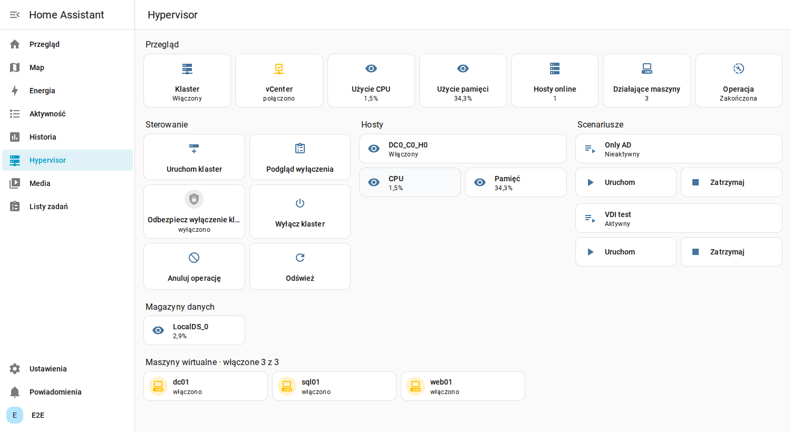
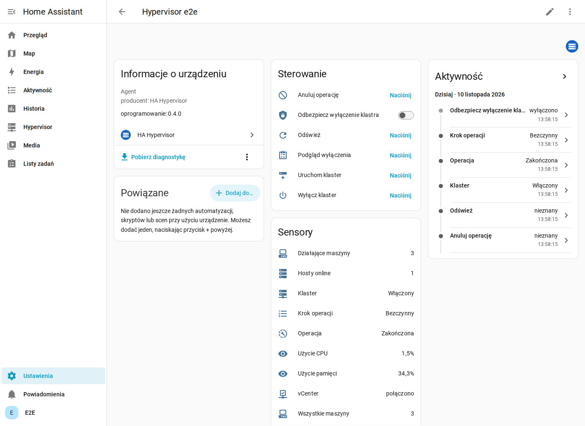
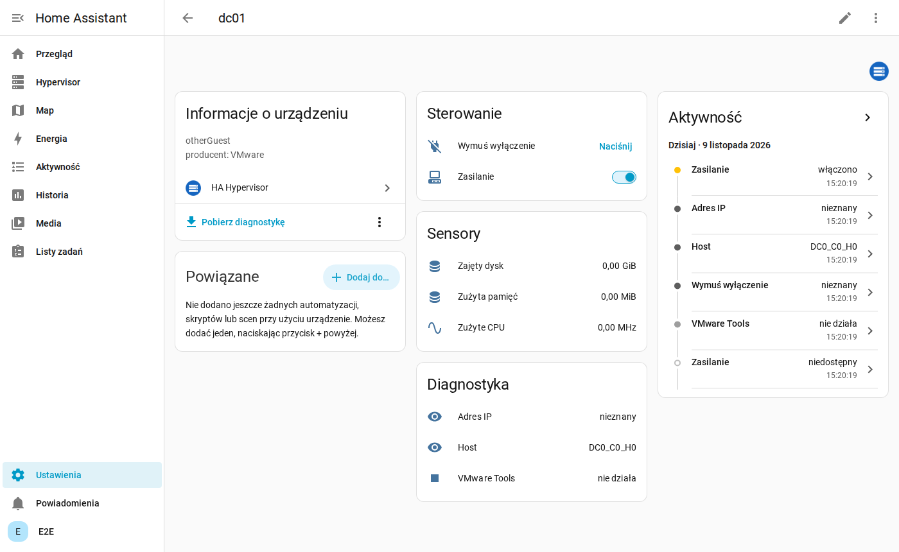
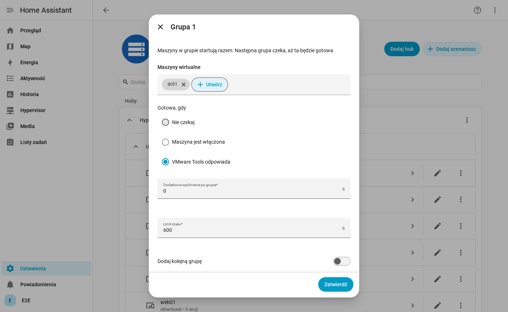

# HA Hypervisor

Sterowanie laboratorium wirtualizacji z Home Assistanta, gdy HA nie ma do niego bezpośredniego dostępu: statystyki,
zasilanie maszyn, wyłączanie i uruchamianie klastra oraz scenariusze startu. Obsługuje VMware vSphere i Proxmox VE 9
(jeden węzeł, klaster, klaster z HA), jeden agent na platformę. Wersja angielska: [README.md](README.md).

**[Instrukcja instalacji](docs/pl/installation.md)**



*Zrzuty pochodzą z Home Assistant 2026.11 połączonego z `vcsim`, symulatorem vSphere, dlatego większość wartości jest
niska, a nazwy hostów są wygenerowane.*

```
Home Assistant + ta integracja  <->  Mosquitto  <--MQTT po TLS--  agent
                                                                    |-- API vCenter i ESXi, albo
                                                                    |-- API Proxmox VE (8006)
                                                                    '-- BMC (Redfish, IPMI), Wake on LAN
```

To agent otwiera połączenie, więc nic nie musi wchodzić do sieci vCenter. Hasła do vSphere i BMC zostają na agencie.

**Agent musi działać poza klastrem**, na zawsze włączonym urządzeniu w sieci zarządzania. Inaczej wyłączy się razem
z klastrem i nic go już nie uruchomi.

Wymaga Home Assistant 2026.11 lub nowszego oraz integracji MQTT.

## Co dostajesz

| Urządzenie | Encje |
|---|---|
| Agent / klaster | stan klastra, użycie CPU i pamięci, hosty online, działające maszyny, operacja i jej krok, przyciski: podgląd wyłączenia, wyłącz, uruchom, anuluj, odśwież, przełącznik odbezpieczenia |
| Host | CPU, pamięć, czas działania, zasilanie, połączenie |
| Maszyna | przełącznik zasilania (wyłączenie przez system gościa), wymuszone wyłączenie, CPU, pamięć, dysk, IP, host, narzędzia gościa, migawki |
| Datastore | zajęte %, wolne, pojemność |
| Scenariusz | uruchom, zatrzymaj, stan |

Sensory liczbowe mają klasę stanu, więc HA przechowuje statystyki długoterminowe. Wartości pochodzą z szybkich
liczników vSphere, przepustowość dysków i sieci nie jest zbierana.

| Klaster | Maszyna wirtualna |
|---|---|
|  |  |

Panel **Hypervisor** powyżej integracja dodaje sama do menu bocznego i buduje go z tego, co zgłasza agent.
Przełączniki maszyn działają w automatyzacjach i z przycisków Stream Decka lub Macro Decka (`switch.toggle`).

## Instalacja

W skrócie, według [instrukcji instalacji](docs/pl/installation.md):

1. Mosquitto z osobnym kontem dla agenta.
2. Agent jako paczka `.deb` (Debian, Ubuntu, amd64 i arm64) albo w Dockerze, na urządzeniu poza klastrem. Połączenia z MQTT, vCenter i ESXi dodajesz przez CLI i sprawdzasz poleceniem `check`.
3. W **Ustawienia, Marketplace, Add from link** podaj to repozytorium, zainstaluj **HA Hypervisor** i dodaj integrację. HACS nie jest potrzebny: Home Assistant 2026.11 zastąpił go wbudowanym Marketplace.

## Wyłączanie klastra

1. **Podgląd wyłączenia** buduje plan. Widać go w atrybutach sensora Operacja, nic się nie zmienia.
2. **Odbezpiecz wyłączenie klastra** odblokowuje przycisk na 60 sekund.
3. **Wyłącz klaster** wyłącza maszyny, włącza tryb Retreat vCLS, wyłącza vCenter, a na końcu hosty.

Zanim cokolwiek zostanie zatrzymane, agent sprawdza vCenter, logowanie do ESXi i to, czy każdy host da się ponownie
włączyć. Jeśli coś się nie zgadza albo działa maszyna z listy `protected_vms`, wyłączenie jest odrzucane. Maszyna
vCenter nigdy nie jest wyłączana siłowo.

**Uruchom klaster** włącza hosty, uruchamia vCenter przez ESXi i wychodzi z trybu Retreat.

## Scenariusze

Scenariusz to uporządkowana lista grup: maszyny w grupie startują razem, a następna grupa na nie czeka (VMware Tools,
stan zasilania lub nic, plus dodatkowe opóźnienie).



Uruchomienie scenariusza włącza też potrzebne hosty i vCenter, jeśli są wyłączone. Zatrzymanie działa w odwrotnej
kolejności i nie rusza maszyn używanych przez inny aktywny scenariusz. W automatyzacji:

```yaml
action: ha_hypervisor.start_scenario
data:
  scenario: Test VDI
```

## Bezpieczeństwo

- Polecenia są podpisane HMAC-SHA256 razem z tematem, wygasają po dwóch minutach, działają tylko raz i nigdy nie są
  retained. Samo konto brokera nie wystarczy do ich wysłania.
- Dane od agenta też są podpisane, sfałszowany stan jest ignorowany.
- Klucz współdzielony jest zapisany we wpisie konfiguracji HA i w konfiguracji agenta.

## Rozwój

```powershell
.\tests\run.ps1 -E2E
```

Wszystko działa w Dockerze. Prawdziwe wyłączenie ESXi i sterowanie BMC wymagają testu na sprzęcie.
