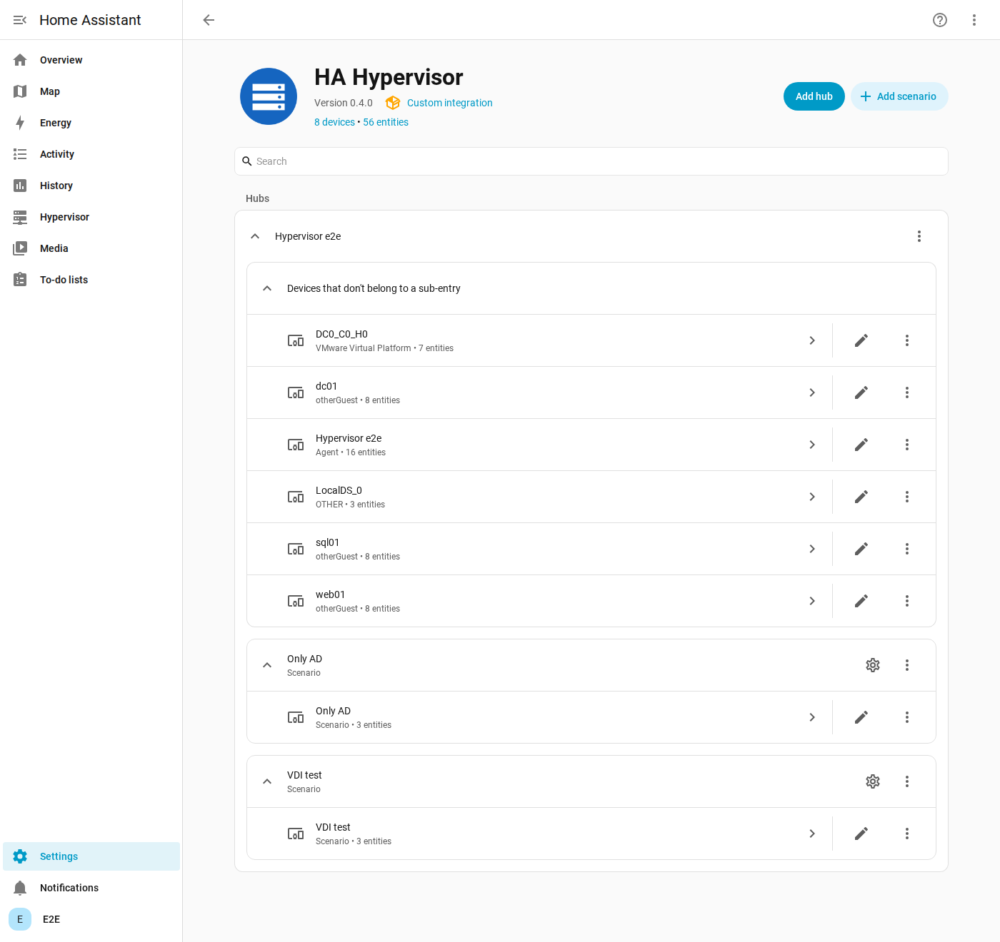
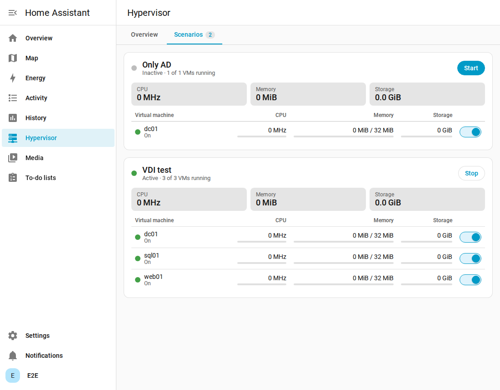
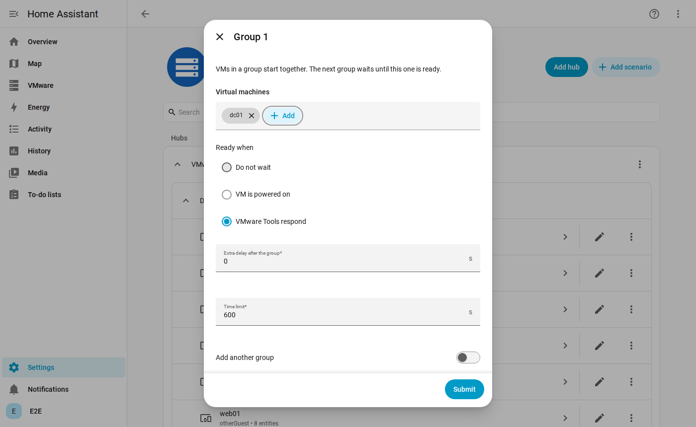
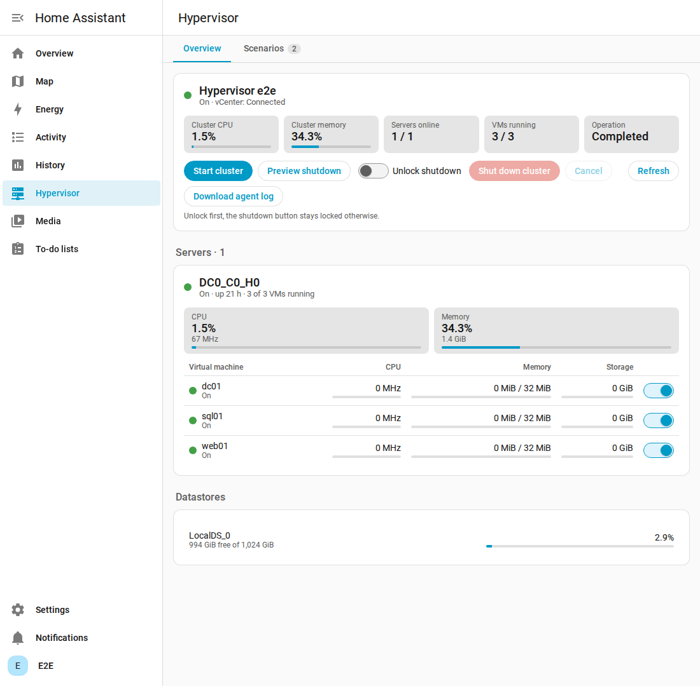

# Installation

Polish version: [pl/installation.md](pl/installation.md).

Order matters: the broker first, then the agent, and Home Assistant last, because adding the integration checks that
the agent answers.

```
Home Assistant + integration  <->  Mosquitto  <--MQTT over TLS--  agent
                                                                    |-- vCenter API (443)
                                                                    |-- ESXi API (443)
                                                                    '-- BMC: Redfish (443), IPMI (623/udp), Wake on LAN
```

## 1. Requirements

| What | Details |
|---|---|
| Home Assistant | 2026.11 or newer, with the MQTT integration. HACS is not needed, the built-in Marketplace replaced it |
| Machine for the agent | Always on, **outside the cluster**, in the vCenter management network, with Debian or Ubuntu (or Docker). A Raspberry Pi, a mini PC or a VM on other hardware |
| Network from the agent | vCenter and every ESXi on 443, every BMC on 443 and 623/udp, the broker |
| Clock | NTP on the agent and on Home Assistant. A command expires after two minutes |
| Hosts | Host names exactly as shown in vCenter |

Do not put the agent on the cluster or on the vCenter appliance. It would stop together with the cluster, and nothing
could start the cluster again.

## 2. Broker

Home Assistant and the agent must use the same broker. These steps use the Mosquitto broker app in Home Assistant.
With your own Mosquitto, apply the same account and ACL.

### Account

In the Mosquitto app configuration, add a login for the agent:

```yaml
logins:
  - username: ha-hypervisor-agent
    password: use-a-long-random-password
```

Enable the ACL so that this account can only use its own topics:

```yaml
customize:
  active: true
  folder: mosquitto
```

`/share/mosquitto/acl.conf`:

```
acl_file /share/mosquitto/accesscontrollist
```

`/share/mosquitto/accesscontrollist`, with `lab` replaced by your `agent_id`. Home Assistant needs its full access:

```
user addons
topic readwrite #

user homeassistant
topic readwrite #

user ha-hypervisor-agent
topic readwrite ha_hypervisor/lab/#
```

Restart the Mosquitto app.

### How the agent reaches the broker

**Option A: MQTT over WebSocket through your reverse proxy (port 443).** No new port is opened. The Mosquitto app
listens for WebSocket on 1884. nginx example:

```nginx
server {
    listen 443 ssl;
    server_name mqtt.example.com;
    # ssl_certificate and ssl_certificate_key as for your other sites

    location /mqtt {
        proxy_pass http://HOME_ASSISTANT_IP:1884;
        proxy_http_version 1.1;
        proxy_set_header Upgrade $http_upgrade;
        proxy_set_header Connection "upgrade";
        proxy_set_header Host $host;
        proxy_read_timeout 3600s;
    }
}
```

In Nginx Proxy Manager add a proxy host to port 1884 and turn on **Websockets Support**.

**Option B: MQTT over TLS on port 8883.** Give the Mosquitto app a certificate (`certfile`, `keyfile`) and forward
port 8883 to it.

Never expose 1883 or 1884 directly to the internet.

## 3. vSphere accounts

### vCenter

Create a role and assign it to the agent account on the vCenter root, with propagation:

| Privilege | Needed for |
|---|---|
| Virtual machine, Interaction, Power on | Starting VMs |
| Virtual machine, Interaction, Power off | Stopping VMs, including guest shutdown |
| Global, Settings | vCLS Retreat Mode |
| Virtual machine, Snapshot management, Create, Revert, Remove | Snapshot actions and scenarios that revert first |

### ESXi

On every host create a local account (for example `svc-ha`) and give it the Administrator role on that host. The agent
needs it to stop and start the vCenter VM and to shut down the host, at moments when vCenter is not running.

With lockdown mode enabled, add the account to **Exception Users**.

## 3b. Proxmox VE instead of vSphere

One agent drives one platform. For Proxmox VE (version 9, tested against a simulator of its API) the agent talks to
the API of each node on port 8006 with an API token. It works the same on a single node, on a cluster without HA and
on a cluster with HA:

| Setup | What the agent does on shutdown and start |
|---|---|
| Single node | Stops the guests, shuts the node down. Start: wakes it, waits for its API |
| Cluster without HA | The same for every node, then waits for quorum on start |
| Cluster with HA | HA guests are stopped through the HA manager (their requested state becomes `stopped`), so none is fenced or moved while the nodes go down. On start, after quorum, the HA resources that ran before are set to `started` again |

Guests are QEMU VMs and LXC containers, templates are skipped. A clean shutdown uses the QEMU guest agent when it is
installed, ACPI otherwise. For a scenario that waits for **tools**, a VM needs the guest agent (`qemu-guest-agent`
inside, **QEMU Guest Agent** enabled in the VM options). Containers count as ready once running.

The agent refuses to shut a cluster down without quorum, because Proxmox would refuse to stop the guests halfway. When
a scenario stops and "power off empty hosts" is on, it keeps enough nodes on for quorum.

Create a user, a role and a token on any node (in a cluster once, it is shared):

```bash
pveum role add HAHypervisor -privs "VM.Audit VM.PowerMgmt VM.Snapshot VM.Snapshot.Rollback VM.GuestAgent.Audit Sys.Audit Sys.PowerMgmt Sys.Console Datastore.Audit"
```

```bash
pveum user add ha-hypervisor@pve
```

```bash
pveum acl modify / -user ha-hypervisor@pve -role HAHypervisor
```

```bash
pveum user token add ha-hypervisor@pve agent --privsep 0
```

The last command prints the token secret once. `Sys.PowerMgmt` shuts nodes down, `Sys.Console` changes HA resource
states, `VM.GuestAgent.Audit` reads guest IP addresses (Proxmox VE 9 replaced `VM.Monitor` with it).

**Agent on the Proxmox node itself.** For a single node the agent can also be installed on the node (Proxmox VE 9 is
Debian 13, run the commands as root without `sudo`). It recognises its node by the host name: it shuts that node down
last, reports the operation as completed just before, and never powers it off as an empty host after a scenario.
The shutdown preview warns with `self_hosted:NODE`. What it cannot do is power the node on again, because the agent
stops with it: start it by hand, from the BMC web interface, or with a BIOS power schedule. For remote start install the
agent on another always-on machine instead. An agent inside a VM or container of the same node is not supported: it
would stop itself together with the guests.

## 4. Server power control

Starting the cluster needs a way to power on a host that is completely off.

**Supermicro BMC:**

1. In the BMC web interface enable **IPMI over LAN** and Redfish (Configuration, Port).
2. Create an account allowed to control power (Operator or higher).
3. Give the BMC a static address reachable from the agent, and keep it off public networks.

The agent tries Redfish first, then IPMI. On some boards and firmware versions parts of Redfish need a license. The
agent then falls back to IPMI.

**Wake on LAN** is an optional last resort. The network card and BIOS must support waking from a full shutdown, the
agent must be in the same network segment, and it cannot be verified in advance. Test it once by hand.

**No BMC and no Wake on LAN.** Add the host with `--manual-power-on` (for example
`esxi add 172.16.2.20 --update --manual-power-on`). The agent then shuts it down like any other, the preview shows
the warning `manual_power_on:HOST`, and **Start cluster** waits up to `host_start` (15 minutes) for someone to press the
power button, then carries on with vCenter and the rest. Without this option such a host blocks the shutdown, so a lab
that nobody can power on again is never switched off by accident.

## 5. Agent

### Install the package

Packages for Debian 12 or newer and Ubuntu 22.04 or newer, on amd64 and arm64 (Raspberry Pi included). The package
brings its own Python and does not touch the system one.

```bash
VERSION=0.10.1
ARCH=$(dpkg --print-architecture)
wget "https://github.com/franekSoftSF/HA-Hypervisor/releases/download/$VERSION/ha-hypervisor-agent_${VERSION}_$ARCH.deb"
sudo apt install "./ha-hypervisor-agent_${VERSION}_$ARCH.deb"
```

The service is enabled but waits for a configuration.

### Configure the connections

Create the configuration. The command prints the **agent ID and shared key** needed later in Home Assistant:

```bash
sudo ha-hypervisor-agent init --agent-id lab
```

MQTT, with option A from section 2. For option B use `--transport tcp --port 8883`. In a trusted local network a plain connection works too: `--transport tcp --port 1883` (TLS is then off):

```bash
sudo ha-hypervisor-agent mqtt set --host mqtt.example.com --transport websockets --username ha-hypervisor-agent
```

```bash
sudo ha-hypervisor-agent mqtt test
```

vCenter. `--vm-name` is the name of the vCenter VM when it runs on the managed hosts:

```bash
sudo ha-hypervisor-agent vcenter set --host vcenter.lab.local --username svc-ha@vsphere.local --vm-name "VMware vCenter Server"
```

```bash
sudo ha-hypervisor-agent vcenter test
```

The test also lists the hosts vCenter knows, so you can see the exact names to use below. Add each ESXi host with its
BMC:

```bash
sudo ha-hypervisor-agent esxi add esxi01.lab.local --username svc-ha --bmc-address 10.0.0.21 --bmc-username ADMIN
```

```bash
sudo ha-hypervisor-agent esxi test
```

**For Proxmox VE** use these instead of `vcenter set` and `esxi add`. The node name is the one shown in Proxmox; add
every node of the cluster with its BMC:

```bash
sudo ha-hypervisor-agent proxmox set --token-id 'ha-hypervisor@pve!agent'
```

```bash
sudo ha-hypervisor-agent node add pve --address 192.168.1.50 --bmc-address 192.168.1.51 --bmc-username ADMIN
```

```bash
sudo ha-hypervisor-agent node test
```

`node test` shows the version, single node or cluster with quorum, the number of guests and HA resources, and nodes
that are not added yet.

**vSphere and Proxmox from one machine.** One agent drives one platform; a second one runs next to it as the service
`ha-hypervisor-agent@NAME` with its own file `/etc/ha-hypervisor-agent/NAME.yaml`, its own state and its own agent ID.
Add `--instance NAME` to every command for it:

```bash
sudo ha-hypervisor-agent init --agent-id proxmox --instance pve
```

```bash
sudo ha-hypervisor-agent mqtt set --host 192.168.1.240 --port 1883 --instance pve
```

```bash
sudo ha-hypervisor-agent proxmox set --token-id 'ha-hypervisor@pve!agent' --instance pve
```

```bash
sudo ha-hypervisor-agent node add pve --address 192.168.1.50 --wol-mac AA:BB:CC:DD:EE:FF --instance pve
```

```bash
sudo systemctl enable --now ha-hypervisor-agent@pve
```

In Home Assistant add the integration a second time with the ID and key printed by `init`. Each agent is a separate
entry and both appear in the Hypervisor panel. Secrets for `--password-env` references of this agent go to
`/etc/ha-hypervisor-agent/pve.env`.

Passwords are asked for interactively and never passed as arguments. Then test everything together and start:

```bash
sudo ha-hypervisor-agent check
```

```bash
sudo systemctl start ha-hypervisor-agent
```

```bash
journalctl -u ha-hypervisor-agent -f
```

Every line of `check` should start with `OK`. `WARN` means the BMC did not answer and only an unverifiable Wake on LAN
is left. The log should say `Connected to the broker`.

### Command reference

| Command | Purpose |
|---|---|
| `init --agent-id NAME` | Create the configuration and a shared key |
| `show` | Print the configuration without secrets, and what is missing |
| `check` | Test all connections, nothing is changed |
| `key show`, `key rotate` | Print or replace the shared key |
| `mqtt set`, `mqtt test` | Broker connection |
| `vcenter set`, `vcenter test` | vCenter connection |
| `esxi add NAME`, `esxi add NAME --update` | Add or change a host |
| `esxi list`, `esxi remove NAME`, `esxi test [NAME]` | Manage and test hosts |
| `proxmox set`, `proxmox test` | Proxmox VE API token, this makes the agent a Proxmox agent |
| `node add NAME`, `node list`, `node remove NAME`, `node test [NAME]` | Proxmox nodes, with the same BMC and Wake on LAN options |
| `--instance NAME` (with any command) | A further agent on the same machine, service `ha-hypervisor-agent@NAME` |
| `update`, `update --check`, `update --file PATH` | Update the agent, see [Update](#update) |
| `autoupdate enable`, `autoupdate disable`, `autoupdate status` | Daily automatic update |

Each command has `--help`. Options of `esxi add` include `--address`, `--bmc-type`, `--wol-mac`, `--wol-broadcast`,
`--no-bmc`, `--no-wol` and `--manual-power-on`.

Restart the service after changing the configuration: `sudo systemctl restart ha-hypervisor-agent`. Each command reminds you. The agent connects to Home Assistant as soon as MQTT is set: it shows the cluster as **Not configured** until vCenter and a host are added, so the integration can be added before that.

For scripts, `--password-stdin` reads the password from standard input (`esxi add` reads the ESXi password first, then
the BMC one with `--bmc-password-stdin`). `--password-env NAME` stores only a reference, with the value kept in
`/etc/ha-hypervisor-agent/agent.env`, which the service loads.

The configuration is in `/etc/ha-hypervisor-agent/config.yaml`, readable only by root and the agent.
`apt purge ha-hypervisor-agent` removes it together with the passwords.

### Alternative: Docker

```bash
git clone https://github.com/franekSoftSF/HA-Hypervisor.git
cd HA-Hypervisor/agent
cp config.example.yaml config.yaml
cp .env.example .env
chmod 600 .env config.yaml
docker compose -f docker-compose.example.yml run --rm ha-hypervisor-agent genkey
```

Put the key and the passwords in `.env`, fill in `config.yaml`, then:

```bash
docker compose -f docker-compose.example.yml run --rm ha-hypervisor-agent check --config /config/config.yaml
```

```bash
docker compose -f docker-compose.example.yml up -d
```

## 6. Home Assistant

1. Set up the **MQTT** integration with the same broker, if it is not there yet.
2. Go to **Settings, Marketplace** and accept the warning. Select **Add from link** and connect your GitHub account when
   asked: the Marketplace requires it for repositories added by link.
3. Enter `https://github.com/franekSoftSF/HA-Hypervisor`, choose **Integration** if asked for the type, and select
   **Add**. Open **HA Hypervisor** and install it. Restart only if a repair asks you to.
4. **Settings, Devices & services, Add integration, HA Hypervisor.** Enter `agent_id` and the shared key.

Hosts, VMs and datastores appear as devices within one polling interval.



### Scenarios

On the integration page choose **Add scenario**, enter a name, and add groups of VMs one by one.

Each scenario has a **Running** switch: on starts it, off stops it, and it stays on while the scenario is active or
partly active. The Start and Stop buttons remain for automations. **CPU**, **Memory** and **Storage** sensors add up
what the VMs of the scenario use, with the value of each VM as an attribute. The **Scenarios** tab of the panel shows
each scenario as its own card: state, Start or Stop, the three sums, and a table of its VMs with CPU, memory and disk,
each with a bar showing its share of the scenario, and a switch per VM.





### Dashboard

The integration adds **Hypervisor** to the sidebar by itself. The panel is built from what the agents report, as cards
in two tabs. **Overview**: one card per agent with the cluster numbers and its controls (start, preview, unlock and shut
down, cancel, refresh), then one card per server with its CPU, memory and every VM it runs, then the datastores. A VM
that moves to another server moves to its card. **Scenarios**: one card per scenario. New servers, VMs and scenarios
show up without any editing; with several agents each gets its own block. Active agents, servers and scenarios come
first, inactive ones drop to the bottom. VMs without a server sit under **Other virtual machines**, folded until you
open it.



To hide it, long-press the sidebar title and hide the entry. To build your own dashboard instead, start from
[dashboard.example.yaml](dashboard.example.yaml).

When the last operation failed, the Overview tab says which one and why, in words. **Download agent log** (for
administrators, agent 0.10.0 or newer) saves the last 2000 lines of the agent log as a file, without SSH to the agent
machine. The same lines are in the diagnostics download of the integration.

### Automations, Stream Deck and other button pads

Every VM that can be powered from Home Assistant has a switch, for example `switch.web01_power`. On turns the VM on,
off shuts the guest down cleanly (VMware Tools). Use the ordinary actions:

```yaml
action: switch.toggle            # or switch.turn_on / switch.turn_off
target:
  entity_id: switch.web01_power
```

The same works from a Stream Deck or Macro Deck plugin for Home Assistant: choose the switch entity and the toggle
action, the key then also shows the VM state. Scenarios and the cluster work the same way through their buttons
(`button.press`) or the actions `ha_hypervisor.start_scenario` and `ha_hypervisor.stop_scenario`. A cluster shutdown
always needs the arm switch first, also from a button pad.

### Snapshots, for example a demo lab that returns to a clean state

Three actions work on VMs of both platforms, selected by device or by any of their entities, also VMs of two agents
at once: **Create snapshot** (`ha_hypervisor.create_snapshot`), **Revert to snapshot** and **Delete snapshot**. Each VM
has a **Snapshots** sensor with the names as an attribute.

- A revert is checked on every selected VM before any is reverted: the snapshot must exist everywhere, vCenter and
  protected VMs are refused. The current state of the VM is lost, that is the point.
- **Include memory** returns to a running VM; without it the VM is off after a revert, **Start afterwards** powers it on.
  Proxmox containers always get a disk snapshot.
- A scenario can **revert to a snapshot before start**: every VM of the scenario returns to it first, then the groups
  start as usual.

```yaml
# After the demo: put the lab back for the next one
action: ha_hypervisor.revert_snapshot
target:
  entity_id: [switch.web01_power, switch.db01_power]
data:
  name: Clean
  start: false
```

Names use 2 to 40 letters, digits, `-` and `_`, starting with a letter (the Proxmox rule, kept on both platforms).

### Agent check after updates

After every start of Home Assistant, also after updating the integration, it asks each agent for its status. A repair
appears under **Settings → System → Repairs** when an agent has not answered within a minute, or when the agent is
older than the integration and should be updated.

## 7. First test

Go step by step, ideally when you can reach the server physically:

1. Turn one unimportant VM off and on with its switch.
2. Press **Preview shutdown** and read the `plan` attribute of the **Operation** sensor. Check the VM list, the vCenter
   host and any `wake_unverified` warning.
3. Power on a host from the BMC web interface once, to confirm the BMC works when the host is off.
4. Run the full cycle: **Arm cluster shutdown**, **Shut down cluster**, wait, then **Start cluster**.

## Troubleshooting

| Symptom | Check |
|---|---|
| `Agent not found` when adding the integration | The agent runs and logs `Connected to the broker`, and HA uses the same broker |
| `Different key` when adding the integration | The same `shared_key` in `.env` and in Home Assistant |
| `is not a valid app repository` | This is the Apps store. Integrations are added in **Settings, Marketplace, Add from link** |
| Actions end with "The agent did not answer" | Clocks on both sides (NTP), agent log shows `Rejected command` |
| `Not authorised` in the agent log | The account and ACL of the broker, `agent_id` in the ACL |
| `no_wake_method` during the preview | The BMC does not answer: run `check` |
| `esxi_unavailable` during the preview | ESXi account, lockdown mode, port 443 from the agent |
| `host_not_configured` | `hosts[].name` differs from the name in vCenter |
| Cluster stays `degraded` after a start | vCenter services need several minutes, watch the Operation step |

## Update

Integration: through the Marketplace. After it, Home Assistant shows a repair for every agent older than the
integration.

### Agent from the command line

```bash
sudo ha-hypervisor-agent update --check
sudo ha-hypervisor-agent update
```

`update` downloads the package for this machine (amd64 or arm64) from the latest GitHub release, compares it with the
`.sha256` file published next to it and installs it. The configuration stays, the running agents, also every
`ha-hypervisor-agent@NAME`, restart on the new version. `--check` only reports and exits with 100 when a newer release
exists. `--version X.Y.Z` picks a release; installing the same or an older version needs `--force`.

The update is refused while an agent runs an operation such as a cluster shutdown: the agent would stop in the middle.
On Proxmox the commands run as root, without `sudo`.

### From a downloaded package

For a machine without internet access, or to keep the file:

```bash
ha-hypervisor-agent update --download-only --dir /tmp
sudo ha-hypervisor-agent update --file /tmp/ha-hypervisor-agent_0.9.0_amd64.deb
```

`--file` also takes a package downloaded by hand from the release page. Keep the `.sha256` file next to it: the
checksum is then compared before anything is installed. Without it the command warns and installs. It refuses a
package of another name or architecture.

### Automatic

```bash
sudo ha-hypervisor-agent autoupdate enable --at 04:30
ha-hypervisor-agent autoupdate status
journalctl -u ha-hypervisor-agent-update
```

A systemd timer runs `update --auto` once a day at the given time (default 04:00, plus up to 30 minutes; a missed run
happens after the next boot). It installs only a newer release, never the same or an older one, and waits for the next
day when an operation is running. `autoupdate disable` turns it off. Without systemd, run
`ha-hypervisor-agent update --auto` from cron as root.

### Docker

`git pull` and `docker compose -f docker-compose.example.yml up -d --build`.
