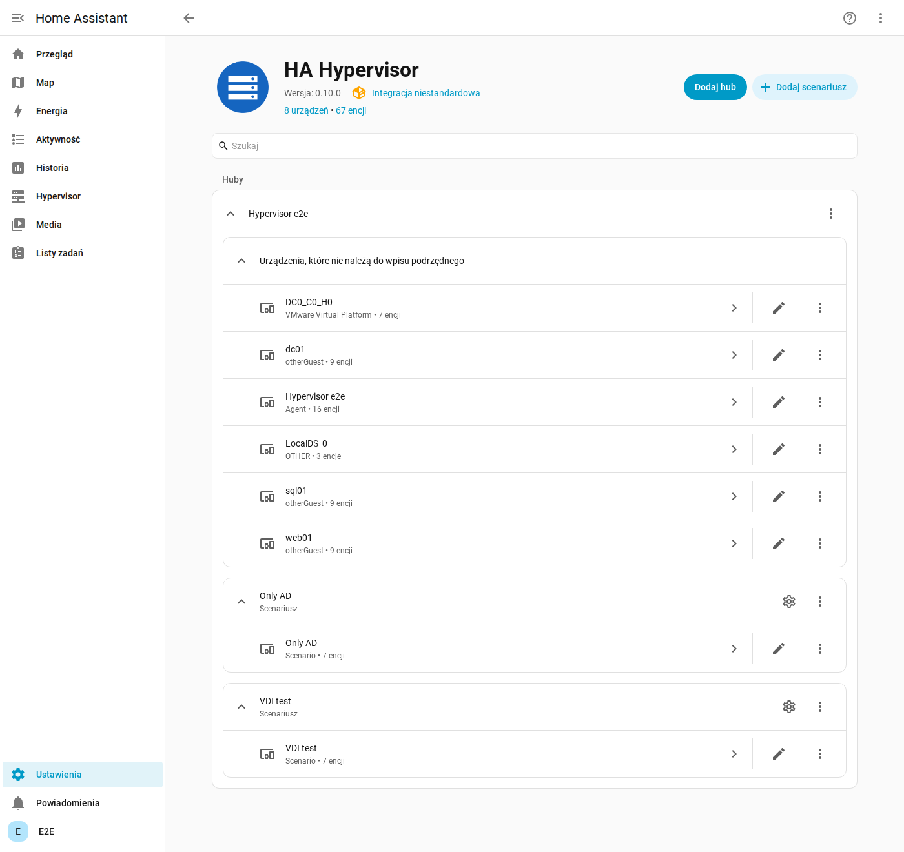
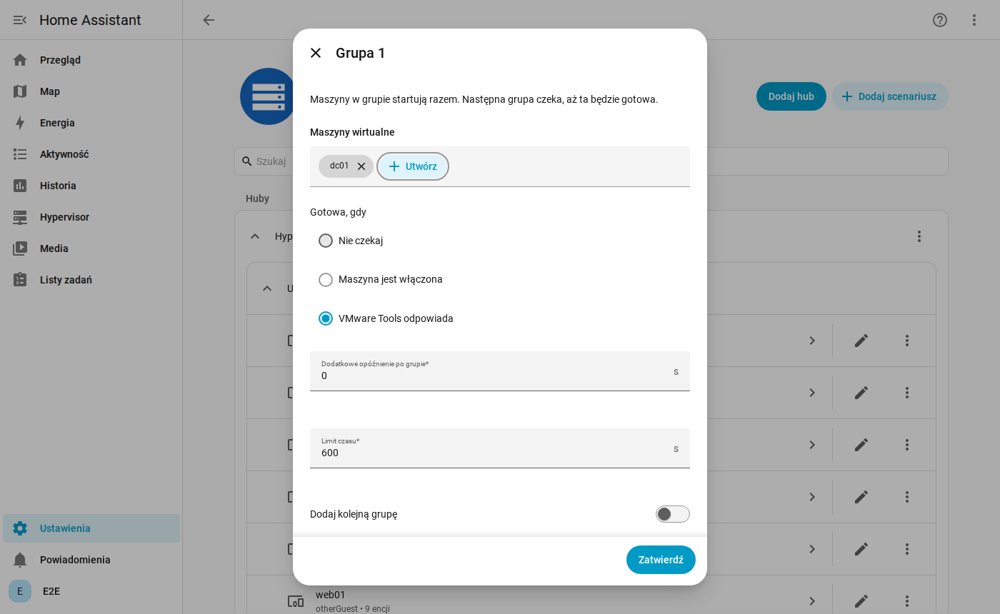
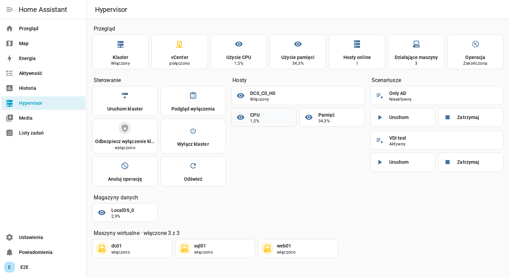

# Instalacja

Wersja angielska: [../installation.md](../installation.md).

Kolejność ma znaczenie: najpierw broker, potem agent, a Home Assistant na końcu, bo dodanie integracji sprawdza, czy
agent odpowiada.

```
Home Assistant + integracja  <->  Mosquitto  <--MQTT po TLS--  agent
                                                                 |-- API vCenter (443)
                                                                 |-- API ESXi (443)
                                                                 '-- BMC: Redfish (443), IPMI (623/udp), Wake on LAN
```

## 1. Wymagania

| Co | Szczegóły |
|---|---|
| Home Assistant | 2026.11 lub nowszy, z integracją MQTT. HACS nie jest potrzebny, zastąpił go wbudowany Marketplace |
| Urządzenie dla agenta | Zawsze włączone, **poza klastrem**, w sieci zarządzania vCenter, z Debianem lub Ubuntu (albo Dockerem). Raspberry Pi, mini PC albo VM na innym sprzęcie |
| Sieć od agenta | vCenter i każdy ESXi na 443, każdy BMC na 443 i 623/udp, broker |
| Zegar | NTP na agencie i na Home Assistancie. Polecenie wygasa po dwóch minutach |
| Hosty | Nazwy dokładnie takie jak w vCenter |

Nie instaluj agenta w klastrze ani na appliance vCenter. Wyłączyłby się razem z klastrem i nic nie mogłoby go ponownie
uruchomić.

## 2. Broker

Home Assistant i agent muszą korzystać z tego samego brokera. Poniższe kroki dotyczą aplikacji Mosquitto w Home
Assistancie. Na własnym Mosquitto ustaw takie samo konto i ACL.

### Konto

W konfiguracji aplikacji Mosquitto dodaj login dla agenta:

```yaml
logins:
  - username: ha-hypervisor-agent
    password: uzyj-dlugiego-losowego-hasla
```

Włącz ACL, aby to konto miało dostęp tylko do swoich tematów:

```yaml
customize:
  active: true
  folder: mosquitto
```

`/share/mosquitto/acl.conf`:

```
acl_file /share/mosquitto/accesscontrollist
```

`/share/mosquitto/accesscontrollist`, z `lab` zamienionym na Twój `agent_id`. Home Assistant potrzebuje pełnego
dostępu:

```
user addons
topic readwrite #

user homeassistant
topic readwrite #

user ha-hypervisor-agent
topic readwrite ha_hypervisor/lab/#
```

Uruchom ponownie aplikację Mosquitto.

### Jak agent łączy się z brokerem

**Opcja A: MQTT po WebSocket przez reverse proxy (port 443).** Bez otwierania nowego portu. Aplikacja Mosquitto
nasłuchuje WebSocket na 1884. Przykład dla nginx:

```nginx
server {
    listen 443 ssl;
    server_name mqtt.example.com;
    # ssl_certificate i ssl_certificate_key jak dla innych serwisów

    location /mqtt {
        proxy_pass http://IP_HOME_ASSISTANTA:1884;
        proxy_http_version 1.1;
        proxy_set_header Upgrade $http_upgrade;
        proxy_set_header Connection "upgrade";
        proxy_set_header Host $host;
        proxy_read_timeout 3600s;
    }
}
```

W Nginx Proxy Manager dodaj proxy host na port 1884 i włącz **Websockets Support**.

**Opcja B: MQTT po TLS na porcie 8883.** Podaj aplikacji Mosquitto certyfikat (`certfile`, `keyfile`) i przekieruj na
nią port 8883.

Nigdy nie wystawiaj portów 1883 ani 1884 bezpośrednio do internetu.

## 3. Konta vSphere

### vCenter

Utwórz rolę i przypisz ją kontu agenta na poziomie głównym vCenter, z propagacją:

| Uprawnienie | Do czego |
|---|---|
| Virtual machine, Interaction, Power on | Uruchamianie maszyn |
| Virtual machine, Interaction, Power off | Wyłączanie maszyn, także przez system gościa |
| Global, Settings | Tryb Retreat vCLS |

### ESXi

Na każdym hoście utwórz konto lokalne (np. `svc-ha`) i nadaj mu rolę Administrator na tym hoście. Agent używa go do
wyłączania i uruchamiania maszyny vCenter oraz wyłączania hosta, czyli wtedy, gdy vCenter nie działa.

Przy włączonym trybie lockdown dodaj konto do **Exception Users**.

## 3b. Proxmox VE zamiast vSphere

Jeden agent obsługuje jedną platformę. Z Proxmox VE (wersja 9, testowane na symulatorze jego API) agent rozmawia przez
API każdego węzła na porcie 8006, z tokenem API. Działa tak samo na jednym węźle, w klastrze bez HA i w klastrze z HA:

| Układ | Co agent robi przy wyłączaniu i starcie |
|---|---|
| Jeden węzeł | Zatrzymuje maszyny i kontenery, wyłącza węzeł. Start: budzi go i czeka na API |
| Klaster bez HA | To samo dla każdego węzła, a przy starcie czeka na kworum |
| Klaster z HA | Maszyny HA zatrzymuje przez menedżera HA (żądany stan `stopped`), więc żadna nie zostanie odgrodzona (fencing) ani przeniesiona, gdy węzły się wyłączają. Przy starcie, po uzyskaniu kworum, zasoby HA działające wcześniej dostają z powrotem stan `started` |

Obsługiwane są maszyny QEMU i kontenery LXC, szablony są pomijane. Czyste wyłączenie używa agenta QEMU, jeśli jest
zainstalowany, w przeciwnym razie ACPI. Scenariusz czekający na **narzędzia** wymaga w maszynie agenta gościa
(`qemu-guest-agent` w systemie i włączone **QEMU Guest Agent** w opcjach maszyny). Kontener jest gotowy, gdy działa.

Agent odmówi wyłączenia klastra bez kworum, bo Proxmox odmówiłby zatrzymania maszyn w połowie operacji. Gdy scenariusz
się kończy z opcją wyłączania pustych hostów, agent zostawia włączone tyle węzłów, ile potrzeba do kworum.

Utwórz użytkownika, rolę i token na dowolnym węźle (w klastrze raz, są wspólne):

```bash
pveum role add HAHypervisor -privs "VM.Audit VM.PowerMgmt VM.GuestAgent.Audit Sys.Audit Sys.PowerMgmt Sys.Console Datastore.Audit"
```

```bash
pveum user add ha-hypervisor@pve
```

```bash
pveum acl modify / -user ha-hypervisor@pve -role HAHypervisor
```

```bash
pveum user token add ha-hypervisor@pve agent --privsep 0
```

Ostatnie polecenie raz pokazuje sekret tokenu. `Sys.PowerMgmt` wyłącza węzły, `Sys.Console` zmienia stan zasobów HA,
`VM.GuestAgent.Audit` odczytuje adresy IP maszyn (w Proxmox VE 9 zastąpiło `VM.Monitor`).

## 4. Sterowanie zasilaniem serwera

Uruchomienie klastra wymaga sposobu na włączenie całkowicie wyłączonego hosta.

**BMC Supermicro:**

1. W panelu BMC włącz **IPMI over LAN** i Redfish (Configuration, Port).
2. Utwórz konto ze sterowaniem zasilaniem (Operator lub wyższe).
3. Nadaj BMC stały adres widoczny dla agenta i nie wystawiaj go do sieci publicznych.

Agent próbuje najpierw Redfish, potem IPMI. Na niektórych płytach i wersjach firmware część funkcji Redfish wymaga
licencji i wtedy agent przechodzi na IPMI.

**Wake on LAN** to opcjonalna ostateczność. Karta sieciowa i BIOS muszą obsługiwać wybudzanie z pełnego wyłączenia,
agent musi być w tym samym segmencie sieci, a działania nie da się sprawdzić z wyprzedzeniem. Przetestuj je raz ręcznie.

## 5. Agent

### Instalacja paczki

Paczki dla Debiana 12 lub nowszego i Ubuntu 22.04 lub nowszego, na amd64 i arm64 (także Raspberry Pi). Paczka ma własnego
Pythona i nie rusza systemowego.

```bash
VERSION=0.5.1
ARCH=$(dpkg --print-architecture)
wget "https://github.com/franekSoftSF/HA-Hypervisor/releases/download/$VERSION/ha-hypervisor-agent_${VERSION}_$ARCH.deb"
sudo apt install "./ha-hypervisor-agent_${VERSION}_$ARCH.deb"
```

Usługa jest włączona, ale czeka na konfigurację.

### Konfiguracja połączeń

Utwórz konfigurację. Polecenie wypisze **ID agenta i klucz współdzielony**, potrzebne później w Home Assistancie:

```bash
sudo ha-hypervisor-agent init --agent-id lab
```

MQTT, dla opcji A z sekcji 2. Dla opcji B użyj `--transport tcp --port 8883`. W zaufanej sieci lokalnej działa też połączenie bez szyfrowania: `--transport tcp --port 1883` (TLS jest wtedy wyłączony):

```bash
sudo ha-hypervisor-agent mqtt set --host mqtt.example.com --transport websockets --username ha-hypervisor-agent
```

```bash
sudo ha-hypervisor-agent mqtt test
```

vCenter. `--vm-name` to nazwa maszyny vCenter, jeśli działa na zarządzanych hostach:

```bash
sudo ha-hypervisor-agent vcenter set --host vcenter.lab.local --username svc-ha@vsphere.local --vm-name "VMware vCenter Server"
```

```bash
sudo ha-hypervisor-agent vcenter test
```

Test pokazuje też hosty znane vCenter, więc widać dokładne nazwy do użycia poniżej. Dodaj każdy host ESXi razem z jego
BMC:

```bash
sudo ha-hypervisor-agent esxi add esxi01.lab.local --username svc-ha --bmc-address 10.0.0.21 --bmc-username ADMIN
```

```bash
sudo ha-hypervisor-agent esxi test
```

**Dla Proxmox VE** zamiast `vcenter set` i `esxi add` użyj poniższych. Nazwa węzła to ta widoczna w Proxmox; dodaj każdy
węzeł klastra razem z jego BMC:

```bash
sudo ha-hypervisor-agent proxmox set --token-id 'ha-hypervisor@pve!agent'
```

```bash
sudo ha-hypervisor-agent node add pve --address 192.168.1.50 --bmc-address 192.168.1.51 --bmc-username ADMIN
```

```bash
sudo ha-hypervisor-agent node test
```

`node test` pokazuje wersję, czy to jeden węzeł czy klaster z kworum, liczbę maszyn i zasobów HA oraz węzły, których
jeszcze nie dodano.

**vSphere i Proxmox z jednej maszyny.** Jeden agent obsługuje jedną platformę; drugi działa obok jako usługa
`ha-hypervisor-agent@NAZWA` z własnym plikiem `/etc/ha-hypervisor-agent/NAZWA.yaml`, własnym stanem i własnym ID agenta.
Do każdego polecenia dla niego dodaj `--instance NAZWA`:

```bash
sudo ha-hypervisor-agent init --agent-id proxmox --instance pve
```

```bash
sudo ha-hypervisor-agent mqtt set --host 192.168.1.240 --port 1883 --instance pve
```

```bash
sudo ha-hypervisor-agent proxmox set --token-id 'ha-hypervisor@pve!agent' --instance pve
```

```bash
sudo ha-hypervisor-agent node add pve --address 192.168.1.50 --wol-mac AA:BB:CC:DD:EE:FF --instance pve
```

```bash
sudo systemctl enable --now ha-hypervisor-agent@pve
```

W Home Assistant dodaj integrację drugi raz, z ID i kluczem wypisanymi przez `init`. Każdy agent to osobny wpis i oba
widać w panelu Hypervisor. Sekrety dla odwołań `--password-env` tego agenta trafiają do `/etc/ha-hypervisor-agent/pve.env`.

O hasła polecenia pytają interaktywnie, nigdy nie podaje się ich jako argumentów. Potem sprawdź całość i uruchom:

```bash
sudo ha-hypervisor-agent check
```

```bash
sudo systemctl start ha-hypervisor-agent
```

```bash
journalctl -u ha-hypervisor-agent -f
```

Każdy wiersz `check` powinien zaczynać się od `OK`. `WARN` oznacza, że BMC nie odpowiedział i został tylko Wake on LAN,
którego nie da się sprawdzić. W logu powinien pojawić się wpis `Connected to the broker`.

### Lista poleceń

| Polecenie | Do czego |
|---|---|
| `init --agent-id NAZWA` | Tworzy konfigurację i klucz współdzielony |
| `show` | Pokazuje konfigurację bez sekretów i czego jeszcze brakuje |
| `check` | Sprawdza wszystkie połączenia, niczego nie zmienia |
| `key show`, `key rotate` | Pokazuje lub wymienia klucz współdzielony |
| `mqtt set`, `mqtt test` | Połączenie z brokerem |
| `vcenter set`, `vcenter test` | Połączenie z vCenter |
| `esxi add NAZWA`, `esxi add NAZWA --update` | Dodaje lub zmienia host |
| `esxi list`, `esxi remove NAZWA`, `esxi test [NAZWA]` | Lista, usuwanie i test hostów |
| `proxmox set`, `proxmox test` | Token API Proxmox VE, od tej chwili agent obsługuje Proxmox |
| `node add NAZWA`, `node list`, `node remove NAZWA`, `node test [NAZWA]` | Węzły Proxmox, z tymi samymi opcjami BMC i Wake on LAN |
| `--instance NAZWA` (z dowolnym poleceniem) | Kolejny agent na tej samej maszynie, usługa `ha-hypervisor-agent@NAZWA` |

Każde polecenie ma `--help`. Opcje `esxi add` to m.in. `--address`, `--bmc-type`, `--wol-mac`, `--wol-broadcast`,
`--no-bmc` i `--no-wol`.

Po zmianie konfiguracji uruchom usługę ponownie: `sudo systemctl restart ha-hypervisor-agent`. Każde polecenie o tym przypomina. Agent łączy się z Home Assistantem już po ustawieniu MQTT: do czasu dodania vCenter i hosta pokazuje klaster jako **Nieskonfigurowany**, więc integrację można dodać wcześniej.

W skryptach `--password-stdin` czyta hasło ze standardowego wejścia (`esxi add` czyta najpierw hasło ESXi, a potem hasło
BMC z `--bmc-password-stdin`). `--password-env NAZWA` zapisuje tylko odwołanie, a wartość trzymasz w
`/etc/ha-hypervisor-agent/agent.env`, który wczytuje usługa.

Konfiguracja jest w `/etc/ha-hypervisor-agent/config.yaml`, dostępna tylko dla roota i agenta.
`apt purge ha-hypervisor-agent` usuwa ją razem z hasłami.

### Alternatywa: Docker

```bash
git clone https://github.com/franekSoftSF/HA-Hypervisor.git
cd HA-Hypervisor/agent
cp config.example.yaml config.yaml
cp .env.example .env
chmod 600 .env config.yaml
docker compose -f docker-compose.example.yml run --rm ha-hypervisor-agent genkey
```

Klucz i hasła wpisz do `.env`, uzupełnij `config.yaml`, a potem:

```bash
docker compose -f docker-compose.example.yml run --rm ha-hypervisor-agent check --config /config/config.yaml
```

```bash
docker compose -f docker-compose.example.yml up -d
```

## 6. Home Assistant

1. Skonfiguruj integrację **MQTT** z tym samym brokerem, jeśli jej jeszcze nie ma.
2. Przejdź do **Ustawienia, Marketplace** i zaakceptuj ostrzeżenie. Wybierz **Add from link** i połącz konto GitHub, gdy
   HA o to poprosi: Marketplace wymaga tego przy repozytoriach dodawanych linkiem.
3. Wpisz `https://github.com/franekSoftSF/HA-Hypervisor`, wybierz **Integration**, jeśli pojawi się pytanie o typ, i
   wybierz **Add**. Otwórz **HA Hypervisor** i zainstaluj. Uruchom HA ponownie tylko wtedy, gdy poprosi o to naprawa.
4. **Ustawienia, Urządzenia i usługi, Dodaj integrację, HA Hypervisor.** Podaj `agent_id` i klucz współdzielony.

Hosty, maszyny i datastore'y pojawią się jako urządzenia w ciągu jednego cyklu odpytywania.



### Scenariusze

Na stronie integracji wybierz **Dodaj scenariusz**, podaj nazwę i kolejno dodawaj grupy maszyn.



### Panel

Integracja sama dodaje **Hypervisor** do menu bocznego. Panel powstaje z tego, co zgłaszają agenci: klaster, przyciski
sterowania, hosty, włączone i wyłączone maszyny, scenariusze i magazyny danych. Nowe maszyny pojawiają się bez żadnej
edycji, a maszyna przechodzi między „Włączone” i „Wyłączone” razem ze zmianą stanu. Przy kilku agentach każdy ma swój blok.



Aby go ukryć, przytrzymaj tytuł menu bocznego i ukryj pozycję. Jeśli wolisz własny panel, zacznij od
[dashboard.example.yaml](../dashboard.example.yaml).

### Automatyzacje, Stream Deck i inne panele przycisków

Każda maszyna, którą można włączać z Home Assistant, ma przełącznik, np. `switch.web01_power`. Włączenie uruchamia
maszynę, wyłączenie zamyka system gościa (VMware Tools). Używaj zwykłych akcji:

```yaml
action: switch.toggle            # albo switch.turn_on / switch.turn_off
target:
  entity_id: switch.web01_power
```

Tak samo działa wtyczka Home Assistant w Stream Decku lub Macro Decku: wybierz encję przełącznika i akcję przełączenia,
przycisk pokaże też stan maszyny. Scenariusze i klaster działają tak samo przez swoje przyciski (`button.press`) albo akcje
`ha_hypervisor.start_scenario` i `ha_hypervisor.stop_scenario`. Wyłączenie klastra zawsze wymaga najpierw przełącznika
odbezpieczenia, także z panelu przycisków.

### Sprawdzenie agenta po aktualizacji

Po każdym starcie Home Assistant, także po aktualizacji integracji, integracja pyta każdego agenta o stan. W **Ustawienia →
System → Naprawy** pojawi się zgłoszenie, gdy agent nie odpowie w ciągu minuty albo gdy jest starszy niż integracja
i trzeba go zaktualizować.

## 7. Pierwszy test

Idź krok po kroku, najlepiej gdy masz fizyczny dostęp do serwera:

1. Wyłącz i włącz przełącznikiem jedną nieważną maszynę.
2. Naciśnij **Podgląd wyłączenia** i odczytaj atrybut `plan` sensora **Operacja**. Sprawdź listę maszyn, host z vCenter
   oraz ewentualne ostrzeżenie `wake_unverified`.
3. Włącz raz host z panelu BMC, aby potwierdzić, że BMC działa przy wyłączonym hoście.
4. Wykonaj pełny cykl: **Odbezpiecz wyłączenie klastra**, **Wyłącz klaster**, poczekaj, a potem **Uruchom klaster**.

## Rozwiązywanie problemów

| Objaw | Co sprawdzić |
|---|---|
| Agent nie został znaleziony przy dodawaniu integracji | Agent działa, ma w logu `Connected to the broker`, a HA używa tego samego brokera |
| Inny klucz przy dodawaniu integracji | Ten sam `shared_key` w `.env` i w Home Assistancie |
| `is not a valid app repository` | To sklep aplikacji. Integracje dodaje się w **Ustawienia, Marketplace, Add from link** |
| Akcje kończą się  | Zegary po obu stronach (NTP), wpis `Rejected command` w logu agenta |
| `Not authorised` w logu agenta | Konto i ACL brokera, `agent_id` w ACL |
| `no_wake_method` w podglądzie | BMC nie odpowiada: uruchom `check` |
| `esxi_unavailable` w podglądzie | Konto ESXi, tryb lockdown, port 443 od agenta |
| `host_not_configured` | `hosts[].name` różni się od nazwy w vCenter |
| Klaster zostaje `degraded` po starcie | Usługi vCenter potrzebują kilku minut, obserwuj krok operacji |

## Aktualizacja

Integracja: przez Marketplace. Agent: zainstaluj nową paczkę przez `apt install`, konfiguracja zostaje. W Dockerze:
`git pull` i `docker compose -f docker-compose.example.yml up -d --build`.
